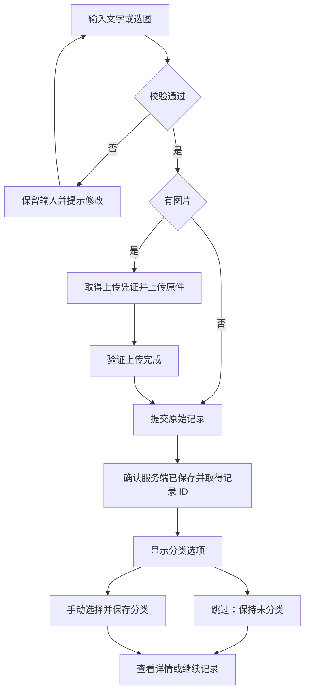

# Personal OS｜M1-01.1 录入与找回流程设计

当前依据已更新为 UX Sprint 01 确认规则及[实施交付](../05-review/ux-sprint-01-implementation.md)。五模块、多领域、标记灵感、统一采集优先于下文历史方案；真实云端仍待网络与数据契约启用。

> 用途：为文字、图片、分类和找回提供可直接实施的页面、状态及验收设计。
> 日期：2026-11-06（Asia/Shanghai）。状态：设计交付；业务实现及 A 用例待执行。
> 依据：Owner 本轮确认七项建议并授权 M1-01.1；[PRD](../PRD.md)及[确认记录](../DECISIONS.md)。

## 本轮范围

完成 F01–F03 的流程、页面状态、接口映射与合成验收样例。复用 Capture、Archive 与首页入口，实际组件改造安排在 M1-01.2～.4。Supabase 已由用户创建，但连接、权限、项目区域和数据状态均未验证。

已确认：五领域单选、未分类可跳过；仅单张 JPEG/PNG，10 MB；保留原始内容，修改说明/分类。按十进制明确 10 MB = 10,000,000 字节，等于上限可接受；前后端与存储策略保持相同字节值。已有原型的 1 MiB 限制是历史实现，不沿用为新规格。

Focus 首页仅一条，由用户主动选定，关联一个方向或项目及一条下一步；该规则记录为 M1-03 输入，本轮不设计完整项目管理。全文编辑、删除、导出/恢复规则另行评审，AI、语音与链接另批。

## 页面与路由

| 页面     | 候选路由 / 复用                                | 内容与操作                                                    |
| -------- | ---------------------------------------------- | ------------------------------------------------------------- |
| 首页     | `/`；现有 Home                                 | 一条 Focus 的后续位置；快速记录入口进入 Capture               |
| 快速记录 | `/capture`；现有 Capture                       | 文字框、添加/更换/移除图片、预览、保存；原文不被标题截断影响  |
| 档案     | `/archive`；现有 Archive                       | 新到旧列表、正文/说明关键词、全部/未分类/五领域筛选；进入详情 |
| 详情     | `/archive/:id`；后续增加详情路由，复用现有展示 | 原文或原图、时间、说明、分类；原件只读，说明/分类可编辑       |

最小手机线框（文字/图片共用表单；下列为设计，不是运行截图）：

```text
快速记录                         档案
[写下内容……              ]       [搜索正文或图片说明       ]
[添加图片]                       [全部领域 v]
[原图预览／更换／移除]            [时间  摘录或缩略图  分类]
[保存]                           [时间  摘录或缩略图  分类]

保存成功                         记录详情
已保存                           时间 · 未分类
[职业][财富][能力][自我][生活]     原文 / 原图（查看原图）
[跳过] [查看记录] [继续记录]       说明：[可编辑文本         ]
                                 分类：[未分类 v] [保存修改]
```

有图片时文字框标为“图片说明（可选）”，其首次保存值单独保留为原始说明；后续可编辑的说明是元数据。无图片时该框是原始文字。仅图片允许保存；文字与图片都没有或只有空白文字时提示。新增说明可供文字记录使用，但首批关键词查询范围保持正文和图片当前说明。

桌面使用同一顺序，可采用受限宽度双栏预览/表单；手机单栏，按钮不被软键盘或底部导航遮挡。标签与错误提示可读，键盘焦点跟随错误字段/成功提示；预览有替代文本。分类不是保存前的必选字段。

## 文字与图片主流程



保存时冻结本次提交快照并防连点。收到确认才清空编辑区；继续记录产生新的请求标识。失败重试使用原请求标识，不能因网络超时而再创建一个副本。若用户修改失败输入，先确认上一请求是否已落库；若已保存，提示打开已保存记录或明确另存新记录，避免把修改后的内容偷偷替换原文。

图片只上传用户选择的原件，不转换/压缩替代原图。文件选择器取消时保留原先选图；选择不支持格式/超限图时保留已有有效输入，并解释原因。上传成功但记录提交失败时复用同一已验证附件。未完成上传不在 Archive 显示为已保存记录。原件校验、重试语义见[API 契约](../02-engineering/api-design.md)。

## 页面状态与恢复路径

| 状态               | 显示及可操作项                                 | 数据行为                                        | 验收          |
| ------------------ | ---------------------------------------------- | ----------------------------------------------- | ------------- |
| 空/编辑中          | 添加图片、输入、保存                           | 保存前不分类，不调用 AI                         | A03、A05      |
| 无效输入           | 对应字段提示；允许修改                         | 不发送创建请求，不清空其他输入                  | A03           |
| 上传/提交中        | 明确阶段，保存防连点                           | 同一请求快照、幂等键；不显示已保存              | A03           |
| 失败或结果未知     | 保留输入；显示重试；超时文案“尚未确认保存结果” | 同键重试以恢复结果，不假定服务端一定未写入      | A03、A11      |
| 已保存/待分类      | 保存成功、分类、跳过、详情和继续记录入口       | 记录先以 null 分类持久化                        | A01、A04      |
| 分类保存中/失败    | 原成功分类仍显示；失败可重试、跳过             | 原件不回滚，待提交选择不冒充已保存分类          | A04、A05      |
| 列表加载中         | 加载反馈                                       | 禁止把请求中显示为无结果                        | A06           |
| 空档案/无匹配      | 分别显示开始记录/清除条件入口                  | 均为成功返回空集                                | A06           |
| 列表或详情读取失败 | 明确失败与重试，旧结果若保留须标为上次结果     | 不用缓存掩盖失败或显示为已同步                  | A06、A11      |
| 说明/分类编辑失败  | 保留当前编辑值，区分上次保存值，允许重试       | 版本冲突要求重新读取并由用户决定再次提交        | A04、A06、A11 |
| 会话失效           | 提示重新登录后重试                             | 页面仍存在时保留草稿；不把私人草稿放 URL 或日志 | A10           |

当前页面内失败保留输入是本批要求。浏览器关闭、系统回收后的持久离线草稿、实时协同、离线写入队列不纳入本切片。登录导航前提示未保存输入；登录方式与恢复细节由 M1-02.1 落实，不承诺刷新后保留文件对象。

## 分类、详情与搜索

分类值为 null 或职业/财富/能力/自我/生活；null 展示“未分类”。保存后选择领域发起独立更新；跳过不请求 AI，也不写默认领域。详情可选择其他领域或恢复未分类。

原文逐字保留换行和空白，仅用 trim 检测是否全空；原始图片字节保持一致。首次图片说明保留为 originalNote；当前 note 可修改或清空，列表/搜索使用当前 note，详情另可查看原始说明。原件字段不进入 PATCH。

搜索采用提交按钮/回车触发；关键词与领域条件取交集。关键词对文字正文、图片当前说明作字面包含匹配，支持中文；不把 `%`、`_` 当通配符，不做分词/语义/OCR。分类改变后重新查询当前列表；旧请求晚返回时不能覆盖新条件结果。先按 createdAt 降序、id 降序稳定分页，避免同时间排序不确定。

## 设计验收与实施交接

可复现合成样例、边界和证据要求见 [M1-01.1 验收设计](../04-testing/m1-01-1-acceptance.md)。本切片完成条件是每个 A01、A03–A06 步骤均能映射到页面状态与接口，A02/A10/A11 跨端权限依赖明确；这些是设计核对，不是功能测试通过。

下一步 M1-02.1：复用用户已建 Supabase，核对用途/现有数据、项目 URL、公开客户端密钥的安全环境配置、本人账户方案与区域，再实现权限基础。私密服务密钥只配置于安全环境，不请求在对话或文档中提供。随后按已批准顺序实施 M1-01.2～.4。
