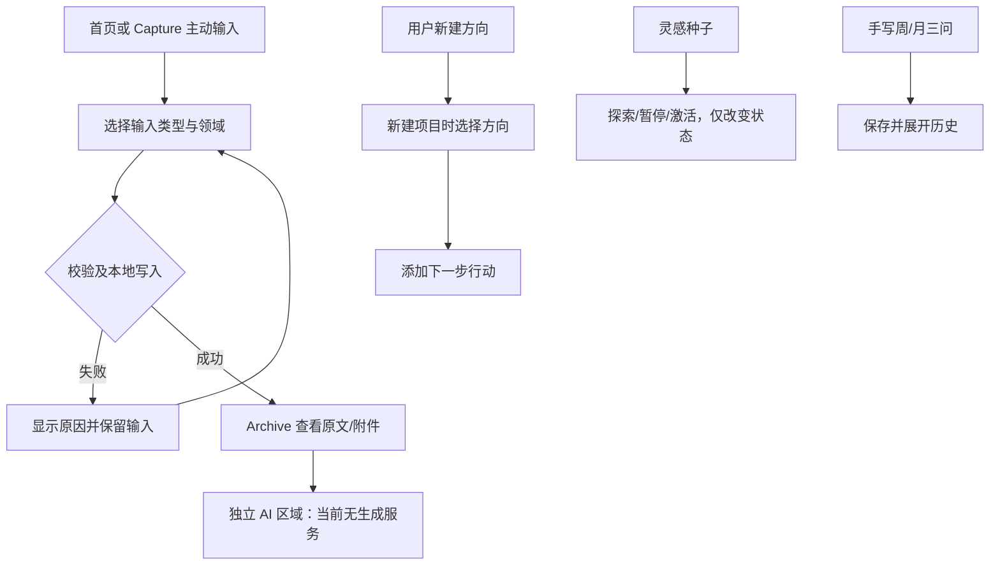

# Personal OS｜用户流程

首批已确认规则及当前设计见 [M1-01.1](m1-01-1-capture-flow.md)。下文“当前可操作”描述原型实现；目标流程中的旧待决项以本轮确认覆盖，其他能力仍另批。

> 用途：分别描述现有可操作流程与新需求的目标流程，避免把设计当作实现。
> 状态：现有流程已核查；目标流程计划中，细则待用户确认。
> 更新：2026-11-06（Asia/Shanghai）。

## 当前可操作流程

目标建议：查看演示提案 → 展示原方向和拟修改标题 → 用户明确确认才应用；取消查看保留待处理，选择“保留原方向”将建议标记为拒绝。没有真实 AI 自动写入。

数据恢复：选择备份 → 校验格式、版本和关系 → 展示覆盖确认 → 确认后写入；无效文件不覆盖现有内容。此流程仅描述产品；开发人员不得对用户真实存储执行演练。

## 目标流程（均为计划中）

| 需求         | 目标流程约束                                                                                   | 尚待决定                                     |
| ------------ | ---------------------------------------------------------------------------------------------- | -------------------------------------------- |
| CAP-03       | 输入 → 选择处理意图 → 默认仅保存；AI 解答/讨论需主动执行；发展作品不自动公开；留待复盘不建任务 | 意图单选/多选与切换历史 Q-03                 |
| FOC-01/02    | 用户选定当前关注 → 显示其关联方向 → 可进入相关项目和行动；未关联时明确显示而不推测             | 独立重点与项目的关系、选择/排序/结束 Q-01/02 |
| IDEA-01/02   | 灵感可收藏、探索、暂停、激活、归档；主动转项目时保留原灵感及转化关联；每次演变可追溯           | 状态与收藏是否独立，归档恢复语义 Q-04        |
| REF-01/AI-02 | 选择周期和历史记录 → 用户手写或主动要求 AI → 展示引用 → 用户判断下一步；无依据时明确缺失       | 周期、五领域引导、引用形式 Q-05              |
| PUB-01       | 从私人记录发展出作品 → 用户选择公开范围并确认发布                                              | 作品对象与公开方式 Q-08；首版可不实现        |

## 核心例外分支

- 原始数据不可读或存储满：当前已有错误提示和原始备份入口；开发人员不得用清空数据替代排查。
- AI 超时、取消、无历史依据：流程计划中，不能显示虚构“成功”；原文应可继续访问。
- 接受提案时目标已变化：当前本地演示无版本并发控制；服务端应检测冲突并重新让用户判断。
- 灵感转化被重复点击：未来需要幂等或显式去重，不能悄悄生成多个项目。
- 所关联方向被删除/归档：当前缺少完整生命周期；未来关系处理需要产品决定，不自动改到另一个目标。
