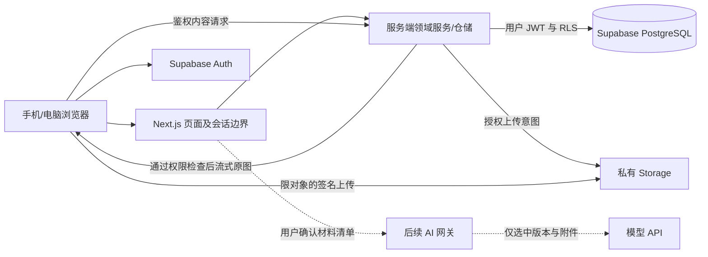

# Personal OS｜技术架构方案 V0.1（T01）

> 用途：比较候选技术、信任边界、费用与替代方案，提出可实施的推荐。
> 状态：技术建议，尚未创建服务、部署或验证云端集成；不是已批准实施方案。
> 更新：2026-11-06（Asia/Shanghai）。
> 依据：[T01 约束](../00-product/t01-product-baseline.md)；当前实现另见 [architecture.md](architecture.md)。

## 推荐：Next.js + Supabase，Vercel 作为可选托管

保留 Next.js/TypeScript 和现有 UI，把 localStorage 适配器逐步替换为用户会话约束的云仓储。结构化数据放 Supabase PostgreSQL，媒体放私有 Storage，Supabase Auth 提供身份。Vercel 候选用于托管 Next.js；数据库和附件不依赖函数本地磁盘。AI 后续通过服务端受限入口接入。

这是单一 Web 应用加托管数据服务，不引入微服务、独立向量库、通用工作流引擎或自动代理。云同步首先建议为在线服务端持久化及跨设备重新读取，不把离线优先、实时协作隐含在“同步”中。

## 候选技术比较

| 技术                 | 作用与推荐原因                                    | 限制 / 潜在费用                                                                 | 可替代方案与取舍                                                                                      |
| -------------------- | ------------------------------------------------- | ------------------------------------------------------------------------------- | ----------------------------------------------------------------------------------------------------- |
| Next.js + TypeScript | 复用已跑通界面、类型与路由；同仓服务端验证和 API  | 框架升级、函数执行限制、会话与缓存错误风险；自托管有算力运维费用                | Vite SPA + Node API：分工清楚但需额外服务；当前重写收益低                                             |
| Supabase PostgreSQL  | 关系约束、事务、RLS，适合私有记录与关系           | 数据库算力、容量、备份/PITR、网络流量；托管维护与区域限制                       | 普通托管 PostgreSQL + 自建 Auth/存储：可替换供应商，集成工作更多；自托管控制强但备份升级负担大        |
| Supabase Storage     | 原图/音频独立保存，私有 bucket 与会话鉴权内容访问 | 对象容量、上传/下载流量、图片处理可能计费；DB 与文件不构成同一事务              | S3 兼容存储：可迁移、选型多，但签名权限与清理流程需自行集成                                           |
| Supabase Auth        | 身份、会话生命周期和与 RLS 对齐的用户 ID          | 注册开放、邮件投递、回调、会话刷新需正确配置；活跃用户、邮件/短信等可能产生费用 | Auth.js + 外部身份提供商，或网关认证：维护更多边界；仅部署密码不能替代数据库所有权校验                |
| Vercel               | Next.js 托管、构建、环境隔离方便，减少运维        | 函数时长/请求体、计算、流量、日志和套餐政策；预览环境不能自动接真实数据         | 普通 Node 托管/容器：控制强、可长任务，但需 TLS、监控、升级；静态托管无法独立承担 AI 密钥与服务端事务 |
| 大模型 API（后续）   | 服务端按明确材料清单处理，返回可选保存结果        | 文本 token、图片、音频转写、重试费用；地域、留存、质量和提示注入风险            | 其他 API 提供商或本地模型：隐私/费用/质量/运维不同；未指定供应商，不绑定某家数据格式                  |

## Auth、RLS 与应用层权限

建议首版关闭公共自助注册，仅预置/邀请产品 Owner。登录方法（邮箱链接、密码、OAuth）与允许身份由用户确认。测试允许在隔离环境创建第二个合成账号验证越权，不意味着产品做多用户社交功能。

每个业务表有 `owner_id`；查询和写入都需验证会话，RLS 的 `USING` 与 `WITH CHECK` 约束 owner_id 等于当前认证用户。关联用 `(id, owner_id)` 唯一键/复合外键，防止甲用户对象指向乙用户对象。Storage 私有 bucket 也要有对应对象策略；仅“路径含用户 ID”不是权限控制。

依据上传 PRD F07/A10，原图下载默认走验证会话的内容端点，后端按该用户的权限读取并流式返回，`Cache-Control: private, no-store`；不将公开、可转发的签名读 URL 暴露为默认原件地址。签名 URL 是持有即授权，在有效期内被复制后也可读取，不能单独满足 A10。直传的签名上传权限应仅限特定待上传对象，不能授予读取其他附件；跨源/伪造 finalize 请求另需校验。

优先选择**用户会话 JWT + Supabase Data API/受控 RPC**处理业务 CRUD。多行事务放在版本化 SQL 函数内，优先 invoker 权限；必须使用 definer 时固定 search_path、限制执行权并复核 owner。所有私有响应禁止进入跨用户公共缓存。应用层校验、CSRF/Origin 检查不能被 RLS 替代。

服务端管理密钥/高权限角色可能绕过 RLS，不能放浏览器、`NEXT_PUBLIC_*`、日志或用作所有日常请求的统一通道。浏览器可见的公开项目键不承担身份保密，安全依赖有效会话和策略。鉴权必须验证 token，不仅解析它。

## Prisma 的选择：保留现状，暂不作为默认云 CRUD 通道

已有 Prisma schema 可复用概念、关系与类型思考，但普通 Prisma 数据库连接并不会自动携带 Supabase 用户 JWT，也不自动获得正确的 RLS 行为。高权限连接更可能跳过策略。

| 方案                                   | 价值                                       | 风险与建议                                                             |
| -------------------------------------- | ------------------------------------------ | ---------------------------------------------------------------------- |
| Supabase Data API/RPC + SQL migrations | JWT/RLS 路径直接，支持 Storage/Auth 一致性 | 需维护 SQL 类型与事务函数；建议云实现采用这一条迁移主线                |
| Prisma + 仅服务端 DB 访问              | ORM 方便，当前模型可延用                   | 每请求身份上下文、连接池/事务与 RLS 需明确验证；不能以应用过滤代替隔离 |

建议获准实施时选择单一迁移权威（Supabase SQL migrations），生成 TS 数据库类型；现有 Prisma 文件先保留为原型历史，不同时驱动两套独立迁移。**本轮不改 schema、卸载 Prisma 或创建迁移**。最终技术选择待确认。

## 同步、部署和长期恢复

- 服务端确认写入才显示“云端已保存”；离线或超时保留输入并区分未同步状态。
- 客户端生成请求幂等键，解决重复点击、超时重试；记录 `version` 实现乐观并发，不静默最后写入覆盖。
- 设备 B 刷新/重新打开可读到设备 A 的已提交数据，作为首个同步基线。实时订阅、离线队列和自动冲突合并是候选扩展，需用户确认。
- 运行时连接和迁移连接分离；若采用直连，核实 serverless 连接池模式、迁移权限和 prepared statement 兼容性。
- Vercel 与数据区域尽量接近；用户所在地可达性、数据驻留、现有账户、域名和预算未确认，不能承诺全球可用或大陆稳定访问。
- 本地 v1 数据迁云必须预览、完整备份、校验计数/文件哈希、显式确认，不自动清空原存储。当前用户身份需绑定后再导入。
- 用户导出覆盖结构化 JSON、关联与原媒体清单/文件；灾难恢复另做数据库和对象存储双份备份及恢复演练。数据库备份不等于媒体二进制备份。恢复点/恢复时间目标及保留期由 Owner 确认。

## 费用评估与资料核验限制

不提供未经核实的“免费可永久用”或固定月费承诺。估算模型：

`每月总成本 = Web 托管/计算/流量 + 数据库计算/容量/备份 + 对象容量/下载流量 + 身份/邮件等附加项 + AI 输入/输出/媒体与重试成本`。

需要用户提供预算区间和大致记录、原图、音频及 AI 使用量，再做容量估算；免费层暂停、资源限额、备份与恢复能力、Hobby 使用政策和超额扣费方式必须开通前核实。成本告警不等于硬性费用上限，硬限制是否可用也需核实。

2026-11-06 尝试读取 Supabase pricing、RLS 文档及 Vercel pricing，均被环境代理以 403 拒绝。以下是**待复核的官方来源入口**，本轮未声称读到其最新内容或当前价格；不为此扩大网络设置、创建账户或购买服务：

- [Supabase Pricing](https://supabase.com/pricing)
- [Supabase RLS](https://supabase.com/docs/guides/database/postgres/row-level-security)
- [Supabase Storage](https://supabase.com/docs/guides/storage)
- [Supabase Auth](https://supabase.com/docs/guides/auth)
- [Vercel Pricing](https://vercel.com/pricing)
- [Vercel Limits](https://vercel.com/docs/limits)

SDK 版本、会话推荐写法、上传限制、当前套餐及条款均需实施前按官方资料验证；本文件是架构设计，不是供应商已集成的证据。
