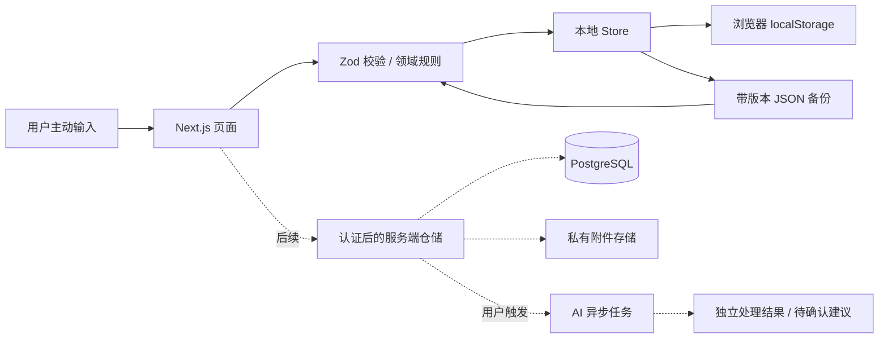

# Personal OS｜技术架构

> 用途：说明现有实现、后续服务端边界与技术限制。
> 状态：现状已核查；后续方案计划中，产品细则待确认。
> 更新：2026-11-06（Asia/Shanghai）。
> 来源：初始 MVP 任务、本轮产品补充、当前工作区及实际执行记录。

## 方案选择

| 层           | 选择                                        | 原因                                                   |
| ------------ | ------------------------------------------- | ------------------------------------------------------ |
| 页面与路由   | Next.js 16 App Router、React 19             | 同一项目可以逐步接入服务端授权、查询与 AI 工作流       |
| 类型与校验   | TypeScript strict、Zod                      | 本地输入和备份校验共用对象定义                         |
| 样式         | CSS 自定义属性、Grid、媒体查询、Lucide 图标 | 当前规模无需额外样式运行时，统一颜色、间距与响应式规则 |
| 一阶段持久化 | localStorage + 版本化 JSON                  | 无需外部凭据便可验证产品流程；未来通过仓储适配器替换   |
| 目标数据库   | PostgreSQL 16+、Prisma 6.19.3               | 关系约束、事务、JSON 扩展；版本与校验器已锁定          |
| 附件目标方案 | 私有对象存储 + 数据库存元数据               | 附件容量与数据库分离；授权后签发短期下载链接           |
| 验证         | Node Test Runner + Playwright               | 独立规则验证与真实浏览器交互验证                       |

Prisma 暂保留成熟的 6.x API 与 `DATABASE_URL` 工作流。接入服务端时单独评估升级和驱动适配器，不在第一阶段引入未经验证的迁移。当前无运行时外部字体、CDN、分析埋点和远程图像依赖。

## 实施阶段

1. 定义原始记录、方向/项目/行动、灵感和复盘关系；明确 MVP 范围。
2. 构建统一导航和首页；提供六大模块、数据设置、本地持久化和导出。
3. 检查类型、构建、模型、浏览器行为；补齐文档和下阶段任务。

以上为前轮 MVP 基础实现的实施过程。认证、服务端写入与 AI 属于后续候选范围；具体先后顺序见当前 Roadmap，尚未作为新一轮开发授权。

## 数据流

首次渲染采用一致的加载状态，挂载后读取本地数据，避免服务端与浏览器 hydration 不一致。保存前校验完整状态，`localStorage.setItem` 成功后才更新 React 状态。损坏数据会阻止普通写入，设置页可先导出原始内容，再明确确认恢复。

## 后续服务端边界

- UI 不持有数据库或 AI 凭据；所有写操作在服务端从 session 获取 `ownerId`。
- Repository 接口按记录、方向、项目、灵感、复盘划分。浏览器 v1 JSON 需通过显式 DTO 映射导入服务器，不直接作为 Prisma create 参数。
- 记录原文采用只追加策略。需要更正时保存新版本/注释，不让 AI 覆盖原文。
- AI 结果记录 model、promptVersion、创建时间；失败任务可重试且必须幂等。
- 接受目标建议必须检验所有权、PENDING 状态、`goalVersion`，在同一数据库事务中更新目标与决策记录。AI 工作任务不拥有目标写权限。
- 标签、记录关联等复合外键防止跨用户关联；仍必须实现每条读写的所有权校验。数据库模型本身不是已实现的授权系统。
- 暂不引入向量库、队列基础设施或复杂微服务。语义检索在实际数据量和体验需求明确后评估 pgvector。

## 当前限制

localStorage 适合流程验证，容量有限，不具备事务、账户隔离或加密，也不能保证跨标签页同时写入的无冲突性。初次体验数据会保存在当前浏览器；无账号登录和跨设备同步。首页统计仅反映当前数据，不提供效率评分。

## 本轮现状核查与架构差距

- Next.js 页面、React Store、Zod 领域校验和本地 JSON 持久化已实现；构建与现有测试已通过，见 [核查报告](../04-testing/verification-2026-11-05.md)。
- 数据库：13 个 Prisma 模型已存在并通过 WASM 校验；没有 migrations 目录、业务 Prisma 调用或数据库实例验证。
- API：没有业务 HTTP handler 或 Server Actions；[API 设计](api-design.md)仅是后续建议。
- 处理意图、独立阶段重点、灵感演变和复盘引用尚无运行模型；新增对象和 v1 备份迁移需单独设计，不能用覆盖当前存储来升级。
- 真实认证、授权和 AI 尚未接入；复合外键是结构约束，不等于服务端数据隔离已经生效。
- 当前没有用户反馈、真实数据规模或性能压测证据，不据此引入微服务或作性能承诺。

重要取舍与历史状态见 [关键决策](../03-development/decisions.md)。
