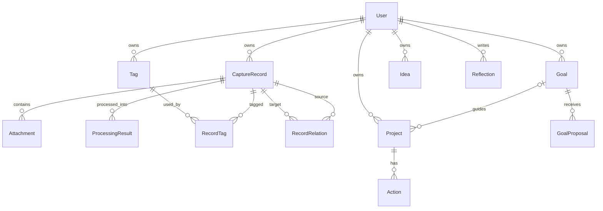

# Personal OS｜数据模型

> 用途：区分当前浏览器对象、Prisma 目标模型与尚未建模的需求。
> 状态：现状已核查；后续方案计划中，产品细则待确认。
> 更新：2026-11-06（Asia/Shanghai）。
> 来源：初始 MVP 任务、本轮产品补充、当前工作区及实际执行记录。

规范定义：[`prisma/schema.prisma`](../../prisma/schema.prisma)。可运行本地模型：[`src/lib/domain.ts`](../../src/lib/domain.ts)。

## 关系图

## 核心对象

| 对象             | 关键字段与规则                                                                            |
| ---------------- | ----------------------------------------------------------------------------------------- |
| User             | 邮箱唯一、显示名、时区；所有业务数据归属于用户                                            |
| CaptureRecord    | 原文 `rawText`、原始链接 `sourceUrl`、输入类型、领域、发生/创建时间；可见性默认为 PRIVATE |
| Attachment       | 私有存储键、原始文件名、MIME、字节数、SHA-256；原始文件与文本独立保留                     |
| ProcessingResult | summary、结构化 JSON、模型、提示词版本；一个记录可以有多个整理版本                        |
| Tag / RecordTag  | 用户内标签名唯一；记录与标签多对多                                                        |
| RecordRelation   | 同一用户记录之间的有向关系及说明；方向对唯一                                              |
| Goal             | 长期方向、理由、时间视野、领域、乐观锁 version                                            |
| Project          | 当前阶段重点，可选关联方向；独立探索不强制绑定长期目标                                    |
| Action           | 项目下的下一步行动、完成状态、排序位置                                                    |
| Idea             | 内容、领域、SEED/EXPLORING/PAUSED/ACTIVE；没有必须创建任务的关系                          |
| Reflection       | 周/月节奏、日期区间、值得记住/新的理解/下一段路三问                                       |
| GoalProposal     | 目标、建议标题、理由、模型、生成时目标版本、待处理/接受/拒绝状态、决定时间                |

五领域映射：职业 CAREER、财富 WEALTH、能力 CAPABILITY、自我 SELF、生活 LIFE。

## 约束与生命周期

- 带有父对象的关系包含 `ownerId` 和父对象 ID，引用父对象 `[id, ownerId]` 唯一键，避免将不同用户对象关联起来。
- 用户删除级联清理其数据；附件二进制对象的删除需后续存储清理任务完成，不能只删除数据库行。
- 删除仍关联项目的 Goal 使用 NoAction；应用必须先明确解除项目关联，避免隐式移除项目。
- 常用查询索引覆盖用户+创建时间、用户+领域、用户+状态和复盘周期。
- Prisma 模型不自动保证原文不可变、决策合法状态迁移或时间区间合理；这些约束需服务端事务、授权和测试实现。正式服务可补充 CHECK/RLS/审计。

## 本地 v1 与服务端的映射

| 本地 v1                              | 服务端目标                                             |
| ------------------------------------ | ------------------------------------------------------ |
| `records[].raw`, `url`               | CaptureRecord.rawText, sourceUrl                       |
| `records[].attachment` 单附件 Base64 | Attachment 元数据 + 私有对象存储；可扩展多附件         |
| `records[].ai` 可空单结果            | ProcessingResult 多版本历史                            |
| `records[].tags` 字符串数组          | Tag + RecordTag                                        |
| `goals/projects/ideas`               | Goal/Project/Idea；领域中文映射数据库枚举              |
| `projects[].actions`                 | 独立 Action 行                                         |
| `reflections[].period` 显示字符串    | 后续补充明确 periodStart/periodEnd，不能仅从字符串推断 |
| `suggestions` 演示建议               | GoalProposal；后续新增真实模型及目标版本               |

当前导出文件根对象为 `{ version: 1, records, goals, projects, ideas, reflections, suggestions }`，不包含账户身份。导入会验证枚举、日期、链接协议、附件 data URL、关联和 ID 唯一性；最大文件 6 MB，完整校验后再请求覆盖确认。向服务器导入需要迁移策略、身份确认和冲突处理，尚未实现。

本阶段验证模型语法与关系，未执行真实数据库迁移或读写测试，因此数据库运行能力不列为已完成项。

## 新需求对模型的影响（仅建议，未修改 schema）

| 新需求                | 当前缺口                                                        | 候选设计与待确认事项                                              |
| --------------------- | --------------------------------------------------------------- | ----------------------------------------------------------------- |
| CAP-03 处理意图       | recordSchema/CaptureRecord 无 intent                            | 意图字段或独立意图事件；单选/多选/历史由 Q-03 决定                |
| FOC-01/02 阶段重点    | Project 同时表示重点；无手动关注顺序                            | 独立关注对象与目标/项目关系、选择顺序；基数待 Q-01/02             |
| IDEA-01/02 生命周期   | Idea 只有当前四状态和 createdAt；无收藏、归档、项目来源或事件表 | 收藏属性、归档语义、IdeaEvent/转化关联为候选名称，Q-04 后再定稿   |
| REF-01/AI-02 历史依据 | Reflection 无 recordIds/引用表，只有自由文本                    | 引用原记录 ID、相关版本及可展示依据；原记录变动后的引用策略待确认 |
| PUB-01 作品与公开     | 无作品及发布对象                                                | 私人原文与作品、发布版本分离；首版不实现                          |

当前导入导出版本仍是 v1，现有数据不受本轮文档任务影响。后续新增字段应定义兼容读取、版本升级、失败回退及备份验证；没有用户确认不得清空数据或按新 schema 强行覆盖旧文件。

## 验证的准确边界

状态校验覆盖顶层集合 ID 唯一性、项目/提案对目标的关联；不是所有未来约束的完整验证。例如 Action ID 的跨项目唯一性、附件字节内容鉴别、所有媒体的解码兼容性、引用历史完整性并未全部验证。Prisma 的用户关联及 goal version 也尚未经过真实事务测试。
