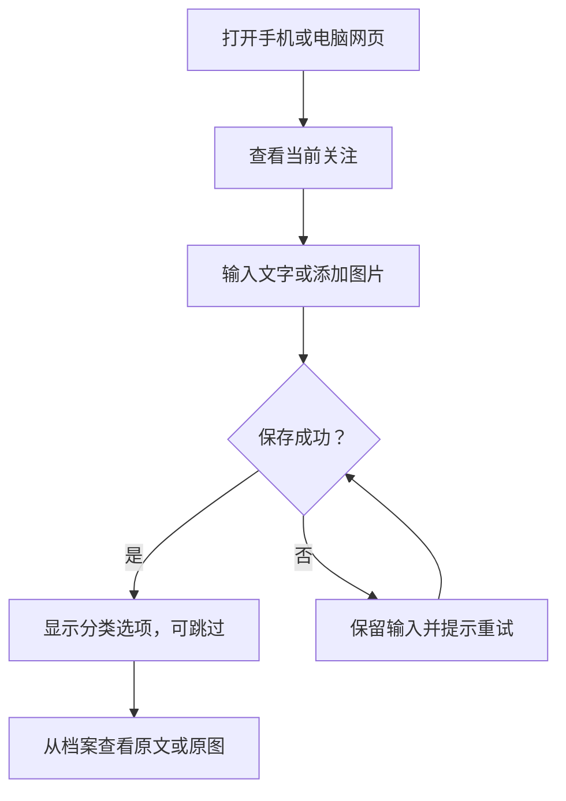

# Personal OS｜产品需求文档 V1.0

## 最新批准：回收站（2026-11-08）

Owner 明确批准原记录/方向/复盘移入、查看、恢复；无永久删除或自动清理，原文附件保留；方向存在 Focus 引用时先由用户解除关联；复盘移除不影响来源。此批准替代下文“删除另行评审”的相应范围，详见[回收站合同](02-engineering/recycle-bin.md)。

## 当前实施状态：UX Sprint 01

用户最新设计与“确认/继续”已授权界面和接入代码实施：五模块、领域多选、记录灵感标记、统一混合采集；Focus 关联/下一步可空，数量不受主卡限制。上述规则替代下文旧单选/单条 Focus 设计。

本轮界面与 Supabase 认证/API 代码已实现；真实云端登录、RLS、持久化和跨设备未联验。2026-11-07 Owner 报告数据库已安装；实际远端五表与两个列表 RPC 均拒绝匿名访问（401/42501），安装已出现可验证迹象。登录邮箱配置已按 Owner 最新回复更新；Owner 已反馈七项安装检查全为 true。本地数据开关已启用供本人联验；真实登录、会话权限、原图保存及跨设备仍待验证，未标记产品验收完成。当前进度与实际边界见 [实施交付](05-review/ux-sprint-01-implementation.md)。

## 本轮确认：M1-01.1

2026-11-06，Owner 明确回复“上述建议全部同意，进入 M1-01.1（supabase已创建）”。确认首批文字/图片、分类/找回、私人云同步及 Focus；AI、语音、链接另批。分类为五领域单选、可跳过/未分类并可后改；单张 JPEG/PNG、10 MB；首页一条主动选定 Focus，关联一个方向或项目及一条下一步；可编辑说明与分类，保留原始内容；全文编辑、删除、导出/恢复另评审。技术采用现有 Next.js/TypeScript 与 Supabase 数据库、Auth、私有 Storage；版本整合以正式文档为准，审查复用原型。

上述对应范围已确认，其余评审稿拟定项不自动批准。Supabase 项目已创建是用户提供的状态，连接、权限、数据库、区域和费用配置仍未验证。本轮仅实施 M1-01.1 的设计交付；[流程](01-design/m1-01-1-capture-flow.md)、[API](02-engineering/api-design.md)、[验收设计](04-testing/m1-01-1-acceptance.md)。

以下保留 V1.0 评审稿正文；与本轮明确确认冲突时以上述确认及后续决策为准。

| 项目       | 内容                                                                                        |
| ---------- | ------------------------------------------------------------------------------------------- |
| 日期       | 2026-11-06（Asia/Shanghai）                                                                 |
| 文档状态   | V1.0 评审稿，已确认的产品边界与待确认的设计分列                                             |
| 产品负责人 | 用户本人                                                                                    |
| 适用版本   | 单人使用的私密 Web MVP，优先交付文字和图片                                                  |
| 需求来源   | 《Personal OS｜需求现状与决策清单 R0.1》及其中 2026-11-06 决策更新，另含本轮生成 PRD 的指示 |

## 1. 产品定位与目标

Personal OS 帮助用户把值得保留的知识、经历、灵感、决策和作品积累成可找回的个人档案。用户可以保存当下材料、看见目前最重要的事情，并在回顾时理解这些事情与长远方向的关系。AI 在用户发起时辅助提取、讨论或复盘，判断和取舍由用户完成。

核心用户为本人。优先解决重复发生的日常问题，例如手机上随手存一张工作截图，之后从电脑找回它，或者在重想职业问题时对照当时的记录。职业、财富、能力、自我、生活是长期组织视角。主业进度、副业和内容创作可先用通用记录承载。

| 视角                   | 用户打开时想知道什么             | 首批体验                                                           |
| ---------------------- | -------------------------------- | ------------------------------------------------------------------ |
| Memory · 过去的沉淀    | 我当时记了什么，在哪里可以找回？ | 主动保存文字和图片，查看记录和原图，按需分类。基础搜索为拟定设计。 |
| Focus · 现在的关注     | 我目前在关注什么，下一步是什么？ | 手机和电脑网页展示当前重点、关联方向或项目，以及一条下一步。       |
| Direction · 未来的方向 | 为什么这个重点值得我投入？       | 在关注项上查看相关方向或项目。最小管理方式见 F06。                 |

### 1.1 试用目标

用一段真实试用观察三个问题。试用时长与通过阈值由产品负责人决定。

| 问题                   | 可观察的信号                                                                             |
| ---------------------- | ---------------------------------------------------------------------------------------- |
| 录入够方便吗？         | 在手机或电脑完成一次文字和一次图片记录。分类选择可以稍后补充，用户能判断内容是否已保存。 |
| 档案能帮我找回东西吗？ | 用户在另一设备找回一条旧记录，能看清原文或原图及录入时间。记录找回失败时记下具体原因。   |
| Focus 帮我理解当下吗？ | 打开首页后，用户能看出某个重点关联什么，以及下一步该做什么。                             |

## 2. 版本边界与优先级

**已确认**对应用户明确选择。**拟定**表示 PRD 提供了可评审的设计方案。**待决**需要产品负责人单独选择。P0 用于首批核心链路，P1 用于增强体验或后续试用。优先级表示交付建议，决策状态仍以各条标注为准。

| ID  | 需求                            | 优先级与范围           | 决策依据                                                            |
| --- | ------------------------------- | ---------------------- | ------------------------------------------------------------------- |
| F01 | 主动保存文字和图片              | P0，首批               | 已确认输入优先顺序，D12、R05–R07                                    |
| F02 | 安静保存，录入后显示分类选项    | P0，首批               | 已确认 D10。可跳过和默认分类维度为拟定设计。                        |
| F03 | 在档案中查看、找回和整理记录    | P0，首批拟定           | R07、R11、R25。列表、详情和基本找回承接录入。搜索和修改范围见规格。 |
| F04 | 保留灵感                        | P1，首批增强候选       | R08 已确认产品需求。以档案标记承载是拟定设计。                      |
| F05 | 手机和电脑网页展示当前关注      | P0，首批               | 已确认 D09、D11，关联方向或项目并展示一条下一步。                   |
| F06 | 维护可供 Focus 关联的方向或项目 | P0，首批最小设计拟定   | R03、R13、R14，服务 D11。拟复用现有对象或提供最小输入。             |
| F07 | 私人访问和云端同步              | P0，首批               | 已确认 D13、D14。登录、部署和存储选型由工程核查后提出。             |
| F08 | 从选定记录发起讨论或回顾        | P1，增强候选           | R10、R14、R15、R23。手动回顾和 AI 讨论的版本归属分开评审。          |
| F09 | 语音和链接录入                  | 后续批次，交付时点待定 | D12。语音上线时提供手动转写，D10。链接正文读取另行选择。            |
| F10 | 图片提字、摘要或推荐分类        | 待决，独立于录入       | D12。分项选择，触发和材料范围遵循 D10、D13。                        |
| F11 | 档案导出、删除及恢复            | 质量方案待评审         | D15。明确数据保留与可迁移能力，定稿后补充发布条件。                 |

公开主页、桌面小组件、主动通知与结构化健康或日程管理列入后续评估。首批行动层采用当前关注和一条下一步。完整任务系统、定时复盘、全库 AI 关联和外部批量自动采集各自需要独立决策。已明确的生活与健康内容仍可用普通记录保存。

## 3. 用户故事与典型场景

下列为验收使用的示例场景。样例数据可以替换成脱敏材料。

| 场景              | 用户故事                                                       | 预期完成结果                                                 |
| ----------------- | -------------------------------------------------------------- | ------------------------------------------------------------ |
| U01 · 随手记录    | 想到一句话时，我希望先把它留下，之后再决定怎么整理。           | 保存后能退出分类界面，回到档案仍能看到原文。                 |
| U02 · 手机到电脑  | 在手机上留下一张有价值的截图，后来在电脑上查看。               | 同一账户能打开同一条记录和原图。用户可补充说明和分类。       |
| U03 · 灵感留存    | 我想留住一个副业或产品想法，暂时没有执行计划。                 | 能保存并再次找到。若启用 F04，可标记为灵感，无需安排任务。   |
| U04 · 找回旧观点  | 重新思考一个问题时，我希望先看看以前怎么想。                   | 按拟定的档案搜索找回原文，结合日期辨认当时的语境。           |
| U05 · 当前关注    | 打开网页时，我希望看到当期的重点、关联方向或项目，以及下一步。 | 浏览首页即可获得行动上下文，并可手动修改。                   |
| U06 · 主动使用 AI | 我选中一条截图或几条记录，希望提字、讨论或回顾。               | 只在已启用的能力和选定材料范围内处理。结果与原记录分别呈现。 |

## 4. 信息架构与用户流程

导航和页面名称为拟定设计，可适配已有工程。

| 页面／入口      | 主要内容                                                     | 主操作                                                   |
| --------------- | ------------------------------------------------------------ | -------------------------------------------------------- |
| 首页 · 当前关注 | 当前重点、关联方向或项目、下一步。保留快速记录入口。         | 查看与维护关注项，进入记录入口。                         |
| 快速记录        | 文字输入、图片选择和预览、保存结果。                         | 写文字、添加图片、保存。成功后可选分类。                 |
| 档案            | 按录入时间排序的记录。按关键词、领域或未分类筛选为拟定设计。 | 找回并打开记录，查看原件。                               |
| 记录详情        | 原文、原图、时间、分类及可选说明。                           | 查看、补充说明、调整分类。已获批的按需处理在这里触发。   |
| 方向或项目维护  | 给 Focus 提供关联项的轻量编辑界面。                          | 创建或编辑名称，从关注项选择关联。可复用已有页面或弹层。 |

关注流程为「填写重点 → 选择关联方向或项目 → 填写下一步 → 首页展示」。关联或下一步尚未填好时，拟允许先保存并显示待补充状态。若未来启用 AI，流程从已保存的记录详情开始，由用户选材料并发起明确操作。

## 5. 功能规格

### F01 · 文字与图片录入

**问题与场景** 想法和截图往往在另一项活动中出现，需要随时存下。首批先验证 U01、U02。

**行为** 支持仅文字、仅图片，以及图片附可选文字说明。拟定最小图片规格为单张 JPEG 或 PNG。实际支持的格式、大小和数量依据用户样本及现有工程确认。文字为空且无图片时显示填写提示。

**流程** 打开录入 → 填写或选图 → 预览 → 保存 → 成功后展示分类选项及查看记录入口。保存成功须对应可从档案重新读取的内容。上传或保存失败时，当前页面保留可重试的输入并给出失败反馈。同一次提交的连点或重试应避免生成重复记录。

**验收** A01、A02、A03。

### F02 · 安静保存与手动分类

**问题与场景** 用户希望立刻留下内容，同时在录入后有整理入口。

**行为** 默认保存路径和手动分类路径均直接处理用户输入。模型调用需要用户另行发起。用户选的类别才写入记录。拟定首批分类项为职业、财富、能力、自我、生活，先支持单选与未分类。多选、自定义类别及 AI 推荐分类属于待确认设计。系统只在已保存后展示分类选项，用户可以跳过或在详情里补选。

**流程** 保存成功 → 选择领域或跳过 → 查看档案 → 后续可修改分类。若分类保存失败，展示上一次成功保存的分类，原记录仍可读取。

**验收** A04、A05。

### F03 · 档案查阅与找回

**问题与场景** 保存需要形成可回看的档案。用户想通过时间、原文或已选领域找回旧记录。

**拟定行为** 列表展示近期记录的时间、文字摘录或图片缩略图以及已选分类。详情可打开原图和查看原文。关键词匹配文字正文与用户填写的图片说明。仅图片且无说明时，可按时间浏览或按已选分类找回。图片中的文字搜索依赖后续获批的提字和索引设计。改分类、补说明与查看原件相互独立。完整编辑、删除或记录版本历史按 D15 和后续规格确认。

**流程** 进入档案 → 浏览或筛选 → 打开详情 → 查看原件或补分类。区分空档案、无匹配结果和读取失败。读取失败提供重试。

**验收** A06。

### F04 · 灵感留存

**问题与场景** 有些想法只值得先留下，可能很久以后才需要回看。

**拟定行为** 通过记录上的「灵感」标记保留和找回灵感。是否首批交付筛选入口由产品负责人决定。保存和标记灵感都由用户完成，下一步和项目关联可留空。

**流程** 保存记录 → 可选标记灵感 → 在档案中按标记查看。

**验收** A07，随 F04 启用。

### F05 · 当前关注

**问题与场景** 打开系统时，希望立刻看见手头重点及其意义。

**行为** 手机和电脑网页均显示用户当前选定的重点、已关联的方向或项目和一条下一步。下一步为简短可编辑文本。拟定支持创建、修改和移出当前关注，移出只改变当前显示。界面显示空状态，用户主动添加第一项。关注项数量和排序方式留给原型评审。

**流程** 新建或编辑关注 → 输入重点 → 选择关联并填写下一步 → 首页查看。方向或下一步尚未填写时，拟显示清楚的待补充状态。

**验收** A08、A09。

### F06 · 方向或项目关联

**问题与场景** 用户想知道一个当前重点为什么重要，而不必重复维护多套计划。

**拟定行为** 提供可命名的方向或项目供 Focus 引用。方向用于表达较长远的目标，项目用于表示正在推进的一件事。先满足关联与展示。若已有可复用对象，优先使用现有对象。首批先评估每个关注项关联一个对象，允许后续扩展。

**流程** 选择已有方向或项目，或创建一个最小条目 → 关联到关注项 → 在首页显示其名称和类型。调整关联时，原有记录仍可访问。

**验收** A08。

### F07 · 私人访问与跨设备同步

**问题与场景** 用户希望手机录入、电脑找回，同时保留对私人内容的控制。

**行为** 同一授权账户可以在手机和电脑查看已保存的内容。访问规则覆盖档案、图片原件、搜索结果、方向和关注项。首批为私人使用。图片地址被复制给未授权访问者时，仍须通过访问控制。云端同步范围包含记录及其相关图片、分类与关注。具体账号方式、同步延迟目标和备份策略随工程评审确认。

**流程** 授权登录 → 保存或编辑 → 从另一设备登录相同账户并刷新 → 查看已保存状态。同步失败时以错误或待重试状态提示。原始内容和访问密钥应避免进入普通日志。

**验收** A02、A10、A11。

### F08 · 主动讨论或回顾

**问题与场景** 旧记录有时能帮助用户重新理解一个问题。

**拟定行为** 手动回顾允许用户查找材料、写下自己的判断并引用选定记录。若批准 AI 讨论，用户选定具体记录后主动发起，界面显示使用范围，输出区分来源、AI 解释和用户结论。讨论结果经用户选择才存入档案。改变方向或关注由用户另行操作。

**流程** 找回记录 → 选择材料 → 手写回顾或在 AI 讨论获批后发起讨论 → 可选保存结果。

**验收** A12、A13，按实际获批的能力启用。

### F09 · 后续语音与链接

**问题与场景** 用户也希望留下口述与外部资料，输入优先顺序在文字和图片之后。

**版本原则** 语音和链接的具体交付批次待定。语音上线时须提供按需转写入口。链接基础录入以保存用户提交的 URL 和可选说明为候选。读取网页正文和摘要分别评审。

**候选流程** 保存录音 → 用户选择转写 → 查看处理结果。保存链接 → 若正文读取获批，用户发起读取 → 查看读取成功或失败状态。转写失败时录音仍可访问。链接不可访问时保留 URL 和用户说明。

**验收** A14、A15，按实际交付范围启用。

### F10 · 图片和文字的按需处理

**问题与场景** 含字截图可能需要复用其中的文字，长文本可能需要摘要。保存与这些处理可独立交付。

| 待决选项 | 能力                                       | 对首批范围的影响                                                 |
| -------- | ------------------------------------------ | ---------------------------------------------------------------- |
| 仅保存   | 保存文字和图片，用户手动分类               | 当前规划基线，保留独立的未来处理入口设计。                       |
| 加提字   | 用户主动对指定图片提取文字                 | 增加结果查看、失败重试，以及是否保存或索引提取文本的决定。       |
| 加整理   | 在提字之外，按需概括文字或图片，或推荐分类 | 需要决定输入材料范围、结果确认方式和是否保存。分类仍由用户选择。 |

**条件流程** 用户选择一条材料并触发已批准能力 → 展示处理中 → 显示结果或失败信息 → 用户决定是否保存结果、使用分类。用户提交的原件、用户编辑与生成结果保持可区分。此次编写 PRD 采用「仅保存」作为可独立交付的工程规划基线。用户仍可选择加提字或加整理。

**验收** A13、A16、A18，按获批的处理能力启用。

### F11 · 数据归属与保留

**问题与场景** 个人档案长期积累后，需要能核对原件、迁移数据并理解删除后果。

**拟定规则** 原图和原文作为用户材料保存。说明、分类及未来生成的处理结果分别维护。导出建议包括原始图片、文字、日期、分类和已实现的关联。删除、恢复、备份保留时长与导入能力列入 D15 评审。若计划存放长期且难以重建的材料，建议先评审导出和恢复方案，并验证一次可读取的备份。

**候选流程** 用户发起导出 → 生成包含内容和附件的可读文件 → 核对记录与图片对应关系。删除与恢复流程在保留规则定稿后补充。

**验收** A17，D15 定稿后启用。

## 6. 数据对象与授权边界

以下为业务字段，用于约束界面、权限和验收。工程可依据既有系统设计存储结构。

| 对象       | 最小字段或关系                                         | 说明                                         |
| ---------- | ------------------------------------------------------ | -------------------------------------------- |
| 记录       | 标识、所有者、录入时间、文字或图片引用、可选分类和说明 | 允许未分类。灵感标记随 F04 交付。            |
| 图片附件   | 标识、所属记录、所有者、原文件引用、类型               | 预览是呈现形式，原件须遵循私密访问规则。     |
| 当前关注   | 标识、所有者、重点标题、是否当前、关联对象、下一步文本 | 一个重点承载一条下一步。关系允许暂时待补充。 |
| 方向／项目 | 标识、所有者、名称、类型                               | Focus 引用，最小管理方式为拟定。             |
| 处理结果   | 选定材料引用、发起时间、处理类型、结果或失败状态       | 条件对象。结果保存由相应功能规格决定。       |

云端同步授权、AI 处理授权和外部访问授权分开执行。任何获批 AI 操作只使用本次明确选定的材料及完成该操作必要的上下文。首批个人数据由授权账户读取和编辑。用户关闭或跳过分类界面后，保存的记录仍可访问。

## 7. 验收清单

核心验收使用两种网页视口或两台设备、同一授权账户和一个未授权会话。失败场景用受控测试模拟。拟定项在纳入交付计划后进入相应批次的验收。

| ID  | 对应     | 可复现步骤                                                                           | 预期结果                                                               |
| --- | -------- | ------------------------------------------------------------------------------------ | ---------------------------------------------------------------------- |
| A01 | F01      | 保存一条含中文的文字记录。刷新并打开详情。                                           | 能看到完整文字和录入时间。                                             |
| A02 | F01、F07 | 手机保存一张图片，可选填说明。电脑用同一账户刷新档案并打开。                         | 看到同一条记录、可查看的原图和已保存说明。                             |
| A03 | F01      | 提交空白记录，随后模拟一次图片上传失败，再恢复并重试。                               | 空白得到提示。失败时保留当前输入并显示重试。成功后只出现一条对应记录。 |
| A04 | F02      | 保存记录并跳过分类。之后打开详情选择领域，再改为另一领域。                           | 原记录先以未分类可查。两次分类修改均可重新读取，内容保持可见。         |
| A05 | F02      | 检查保存、跳过分类和手动改分类时的模型调用记录。                                     | 三种操作均没有模型调用。                                               |
| A06 | F03      | 按拟定设计保存两条不同记录，补填一条图片说明，以正文词或说明词搜索，再筛选分类。     | 补填说明可再次读取。匹配项可打开原件。无匹配和读取失败有可区分的反馈。 |
| A07 | F04      | 把一条记录标为灵感，稍后从档案找回。                                                 | 标记可查询。该记录没有新增待办、项目或提醒。                           |
| A08 | F05、F06 | 建一条重点，关联方向或项目并填写下一步。在手机和电脑打开首页。                       | 两端都显示相同重点、关联名称与下一步。                                 |
| A09 | F05      | 修改下一步并移出当前关注。                                                           | 首页显示更新后的值。移出后首页不再列出该关注，既有档案记录仍可读取。   |
| A10 | F07      | 用未授权会话尝试打开记录详情、搜索入口和已知图片地址。                               | 私人内容不可读取。页面或接口按权限返回登录提示或拒绝。                 |
| A11 | F07      | 在设备 A 修改分类或关注项，待保存成功后在设备 B 刷新。模拟一次同步请求失败。         | 同账户可读到已成功保存的值。失败状态清楚，未提交内容不显示为已同步。   |
| A12 | F08      | 查找两条旧记录，写一段自己的回顾并保存。                                             | 可以再次查看回顾及所选来源，个人判断清楚可辨。                         |
| A13 | F08、F10 | 选定一条记录后发起已获批 AI 操作，档案另存一条未选的对照记录。                       | 请求材料限于选定内容。AI 结果可辨识，原件和当前关注保持用户设定。      |
| A14 | F09      | 保存一段语音，确认保存后手动点「转写」，再模拟一次转写失败。                         | 转写仅在点击后触发，失败有反馈，录音仍可查看。                         |
| A15 | F09      | 保存一个可访问和一个不可访问的 URL。若正文读取已启用，分别主动读取。                 | URL 和说明都可保存。读取失败明确显示，结果不冒充原网页内容。           |
| A16 | F10      | 对一张指定截图主动提字，另用一张无字图片复测。                                       | 有文字时显示可核对结果。无文字或失败时提示状态，原图仍可查看。         |
| A17 | F11      | 在导出规格确定后，导出含文字和图片的测试档案。打开导出物核对内容与关联。             | 内容范围符合约定，文件可读，记录和附件能对应。                         |
| A18 | F10      | 若摘要或推荐分类获批，选定一条记录，发起相应整理操作。查看结果，然后选择采用或退出。 | 摘要独立显示，原文或原图仍可查看。分类建议在用户采用后才写入记录。     |

首批核心链路由 A01–A05、A08、A10、A11 覆盖，拟定对象与流程须先落实适用范围。A06 对应首批拟定的基础找回。其余用例随批准的能力生效。所有用例状态为待执行。

## 8. 路线图与待决项

| 阶段              | 交付或评审重点                                                                             | 进入下一步的条件                                 |
| ----------------- | ------------------------------------------------------------------------------------------ | ------------------------------------------------ |
| M0 · 工程核查     | 盘点既有代码、数据和权限。使用示例内容画出移动端录入、档案、首页及错误状态。               | 工程差异、复用路径和待决项明确。                 |
| M1 · 首批核心     | 文字与图片保存、分类、档案基本查阅、私密跨设备访问、当前关注。                             | 核心用例通过，用户用真实或脱敏样本完成一轮体验。 |
| M2 · 档案增强候选 | 依据使用反馈决定灵感标记、回顾、讨论、图片提字或整理的价值和顺序。获批的增强可随 M1 交付。 | 各能力分别明确触发方式、数据范围与验收用例。     |
| M3 · 后续输入     | 在文字和图片稳定后，安排语音、手动转写及链接录入。                                         | 录音、URL 保存和可选处理分别验收。               |
| 后续评估          | 桌面小组件、主动通知、公开主页、结构化健康与日程、领域专用工具。                           | 有重复出现的使用场景或试用证据，再确定顺序。     |

M2 与 M3 为候选路线，取舍依真实使用和用户批准。表中顺序保留文字／图片先于语音／链接的确定约束。

| 待决项                                   | 当前处理方式                                                             | 需要谁决定                                             |
| ---------------------------------------- | ------------------------------------------------------------------------ | ------------------------------------------------------ |
| O01 · AI 处理范围（D12）                 | 首批按文字／图片保存设计。OCR、摘要、推荐分类、图片解读均可独立评审。    | 产品负责人按具体能力选择。                             |
| O02 · 分类维度与查找（D10、R04、R11）    | 拟用五领域单选、未分类和基础关键词查找。                                 | 产品负责人确认，原型验证分类是否造成负担。             |
| O03 · 数据保留（D15）                    | 拟保留原件并分别保存派生结果。明确导出、删除、备份和恢复后再定对应验收。 | 产品负责人和开发共同评审。                             |
| O04 · 工程与存储（D16）                  | 查现有项目，再提出账户、云端数据库、图片存储、备份及同步方案。           | 开发提出方案，产品负责人评估隐私、维护成本和迁移能力。 |
| O05 · 后续功能批次（D12、R08、R10、R23） | 分别确认语音／链接、灵感标记、手动回顾和 AI 讨论的交付时间。             | 产品负责人根据试用反馈决定。                           |

## 9. 决策日志与需求追踪

R、D 编号沿用 R0.1。F 为本 PRD 功能编号，A 为验收编号。

| 决策         | 结论                                                                       | 状态／影响                                               |
| ------------ | -------------------------------------------------------------------------- | -------------------------------------------------------- |
| D01–D04、D07 | 私人知识与人生档案，主动输入，灵感可以只留存，以过去、现在、未来组织价值。 | 已确认。F01、F03–F06。                                   |
| D05          | 区分安静保存、深入讨论和找回旧观点。                                       | 原则已确认。F02 首批，F03 作为找回设计，F08 版本待评审。 |
| D06、D08     | 保留产品与开发演进。当前任务交付需求文档。                                 | 已确认。第 10 节给出交接步骤。                           |
| D09／1A      | 手机与电脑网页展示当前关注。                                               | 已确认。F05、A08。                                       |
| D10／2A      | 安静保存，录入后显示分类选项。语音上线时可主动转写。                       | 已确认。F02、F09，A04、A05、A14。                        |
| D11／3A      | 当前重点、关联方向或项目、一条下一步。                                     | 已确认。F05、F06，A08、A09。                             |
| D12／Q4      | 文字和图片优先，其后语音和链接。                                           | 顺序已确认。处理能力与具体后续批次待定。F01、F09、F10。  |
| D13／5A      | 接受云端同步，AI 初期只处理明确选定的材料。                                | 已确认。F07、F08、F10，A10、A11、A13。                   |
| D14／6A      | 首版私人使用，公开主页后置。                                               | 已确认。F07、A10。                                       |
| D15、D16     | 数据保留与迁移规则、技术栈和既有工程。                                     | 待评审。F11、O03、O04。                                  |

## 10. 给 Codex 的开发交接

**首个任务建议** 将本 PRD 和 R0.1 放入 Codex 工作上下文。先核对已有工程，再提供首批任务拆分。用户曾提交过开发任务，现有代码、测试和部署状态需要由 Codex 核查。

> 依据《Personal OS PRD V1.0》和《需求现状与决策清单 R0.1》的最新决定，先读仓库说明并盘点现有页面、持久化、身份和附件访问。给出可复用模块、缺口、拟修改文件和验证方式。首个可运行切片覆盖手机或电脑输入文字与图片、保存、手动分类以及重新打开原文或原图。之后衔接私密跨设备读取和 Focus。按 F／A 编号给出实现顺序、验收及数据风险。将图片提字、摘要、推荐分类和 AI 讨论保留为独立待决项。此轮交付工程盘点、技术选项和任务拆分。

开发获准后，建议按以下顺序推进：

1. 用示例材料走通录入、可选分类、档案详情和失败重试。将 F01–F03 拆成能单独验证的小切片。
2. 接入或验证授权访问和云端同步，覆盖图片原件权限。用 A02、A10、A11 检查同账户与未授权会话的行为。
3. 完成 Focus、最小关联和下一步展示，用 A08、A09 在手机和电脑上验收。
4. 把实测结果、已知问题和用户体验反馈写入开发记录。下一批只纳入负责人确认的增强项。

工程建议交付物包括范围差异表、最小页面线框、数据与权限说明、带 F／A 编号的任务清单。开发日志记下日期、实施项、所做取舍、验证证据和未决问题。技术方案可以比较已有方案的复用成本、私密访问、备份恢复和维护负担，具体选择记录到相应决策项。

## 11. 文档演进

| 版本         | 内容                                                         |
| ------------ | ------------------------------------------------------------ |
| Concept V0.3 | 历史构想与用户需求来源，由 R0.1 索引。                       |
| R0.1         | 提取并区分用户表述、建议和待决项，补记 2026-11-06 用户选择。 |
| PRD V1.0     | 把已确定边界转化为首批规格、拟定方案、验收和 Codex 交接。    |

来源文件见 [需求现状与决策清单 R0.1](reference/REQUIREMENTS-R0.1.md)。
